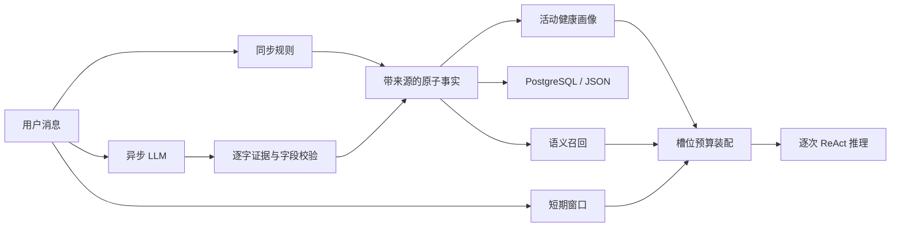

# 三层记忆系统：原子事实、健康画像和上下文预算

## 本次修改对应的问题

| 问题 | 当前行为 |
|---|---|
| 原文分类后直接进入长期记忆 | 同步规则/异步 LLM 提取原子事实；问题、假设、建议不直接写入 |
| 助手建议污染用户事实 | 助手回复只进入短期窗口 |
| 健康类别 KV 覆盖旧值 | 画像读取同一份长期事实，多值并存、指标保留时间记录 |
| 无法区分补充和纠正 | 属性、值、否定、操作分离，纠正产生 supersedes 链和版本号 |
| 重复执行重要性衰减 | 从 baseline 与固定 anchor 计算；相同 now 重跑得到相同结果 |
| 规则兜底在后台 | 明确用户陈述在 add_message 返回前写入，后台只补充 |
| JSON 示例触发格式化错误 | 指令与输入分消息传递，JSON 示例不经过 str.format |
| 整块删除历史/画像 | 事实逐条注册槽位，局部预算后再进行全局优先级裁剪 |
| 后续工具观察不计预算 | 每次 ReAct 调用前重新装配，覆盖指令、工具、用户问题和观察 |
| 图记忆未落地 | 删除图记忆类、入口、参数和导出；医学知识图谱检索仍属于 RAG |

## 数据流



## 事实契约

AtomicFact 保存 subject、predicate、value、evidence（逐字来源）、source_message_id、source_session_id、source_role、recorded_at、effective_at、confirmation_status、negated、operation、fact_id、version、supersedes、status。

- 记录时间使用 UTC；有效时间未知时为 null，不用记录时间冒充生效时间。
- 自述状态为 self_reported，不等于医生确认。LLM 不能自行提升确认状态。
- family_history 的主体可以是明确提到的父亲/母亲，而不把亲属疾病记在用户身上。
- 普通用户对话只接受明确自述；抽取采用保守准入策略，可能漏掉复杂表达。
- LLM 输出需要完整陈述片段作为证据，属性在允许列表中，值必须出现在证据中，否定必须一致。这个检查降低错误，但不能证明医学事实本身真实。
- 整句原始问题的 embedding 不得用于拆出的多个事实。使用独立事实文本的 embedding；不可用时采用词频余弦兜底。

## 集合、时间序列与版本

过敏原、疾病和长期药物支持多个值。血压、血糖、体重以独立属性和每次观察时间保存，同值不同消息也保留时间记录。当前画像只选择每个体征最新有效时间的观测；历史样本仍可按时间查询或召回。同一消息的规则与 LLM 结果不会重复插入。

明确否认某个旧值或提供 replaces_value 时，将旧活动记录标为 superseded，创建带 supersedes 的新记录；撤回用 retracted。历史不用于当前召回，但保留查询与审计能力。姓名/城市等单值字段的更改也形成版本。延迟返回的旧 LLM 结果不会重新激活已被新消息纠正的值。

不同属性值、否定状态或时间观测不能仅因向量相似而合并。原子事实按结构键去重；显式 trusted 文本接口 remember 仍支持 SHA-256 + embedding 双阶段去重。通用文本的后台合并保留分类、标签和槽位元数据。不要把“语义相似”当成“事实一致”。

## 生命周期与持久化

importance = base_importance × decay_rate ^ elapsed_days，自固定 decay_anchor 计算。TTL 条件为 age > ttl_days AND importance < min_importance；不是到期立即删除。单条记录也参与维护，版本历史保留用于审计。

PostgreSQL 的版本更新、新增和删除在一次事务中提交，全部写入按 username 限定。重复命中、访问时间和衰减更新也会持久化。失败的变更留在待重试队列，下次写入时重试。JSON 使用原子替换快照。数据库不可用时当前请求仍可在进程内运行，但重启前未持久化的数据可能丢失。

同一进程同一用户共享长期层，不同会话拥有独立短期窗口；多进程之间仍需显式缓存失效机制，当前不宣称强一致。

## 上下文槽位

Schema 定义 constraints / profile / planner / task_memory / tool_state / recall_memory，并额外支持近期对话。chat、tool、rag、react 选择相应槽位，未知模式回落到 chat。

健康事实逐条装配。过敏史、慢性病史和长期用药标记 required；约束与当前问题、工具声明同样保留。其他资料先做单槽位裁剪，再按优先级在全局预算下删除。required 内容放不下时抛出 ContextBudgetError，不能静默删除关键约束。

服务传递带槽位元数据的 ContextText（兼容 str），将记忆、病例摘要、元数据交给 ReAct。每次模型调用前重新预算当前观察。动作与对应观察作为一组处理，避免只保留孤立一半。

默认采用保守 UTF-8 字节预算，不宣称是模型 tokenizer 的精确 token 数；ReActEngine 可注入模型对应 token_counter。预算包含消息包装预留和输出预留。默认窗口是 32768 个保守预算单位，输出预留 2048；部署时应按实际模型窗口配置。

## 升级

新库：`scripts/create_tables.sql`。

已有库：先备份，再执行可重复的增量脚本：

```sh
psql -d ragqa_memory -f scripts/migrations/2026-10-21-atomic-memory.sql
```

新增 base_importance、decay_anchor、fact JSONB。旧分数作为迁移基线，从迁移时刻开始计算后续衰减。不会把旧聊天原文伪造成有来源的原子事实；旧 KV 画像会明确标注“来源与时间未知，未经确认”。旧资料需要通过用户重新陈述或人工校对才能成为新格式的已知来源事实。

本次修改不删除数据库中的任何既有业务资料，也不操作医学知识图谱数据。

## 验证

`tests/test_atomic_memory.py` 覆盖提问/假设过滤、拆分来源、同步可见、多值与时间记录、纠正/否定、迟到结果、清空后的后台回写、JSON 恢复、幂等衰减、单条过期、数据库事务参数/重试和逐次推理预算。现有记忆和 Harness 集成测试用于验证兼容路径。

没有为这次修改虚构记忆效果指标；提取覆盖率和真实多轮回答效果仍需独立评测集验证。
